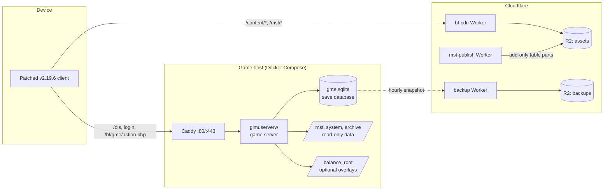

# Architecture

This document describes how the components in this repository fit together: what runs where,
how a client request travels, where data lives, and how optional overlay files reach players.
Host names below are placeholders (`api.example.com`, `cdn.example.com`).

- [Components](#components)
- [Overview diagram](#overview-diagram)
- [Request flow](#request-flow)
- [Data flow](#data-flow)
- [Overlay files](#overlay-files)
- [Where to read next](#where-to-read-next)

## Components

| Component | Path | Runs as | Role |
|---|---|---|---|
| Game server | `server/` | `gimuserverw`, a Drogon HTTP server (C++23) | Answers every request the client sends: boot discovery, login, and the game's encrypted actions. Owns the SQLite save. |
| Packet generator | `server/packet-generator` (vendored fork, MPL-2.0) | Rust tool run at build time | Generates the C++ request/response structures from KDL schemas. |
| CDN Worker | `cdn-worker/src/` | Cloudflare Worker `bf-cdn` + R2 bucket | Serves the client's downloadable files (`/content/*`, `/mst/*`). |
| Table publish Worker | `cdn-worker/mst-publish/` | Cloudflare Worker | Add-only sink for client table parts; refuses to overwrite a key with different bytes. |
| Backup Worker | `cdn-worker/backup/` | Cloudflare Worker | Write-only sink for gzip'd SQLite snapshots; no read, list or delete. |
| Uploader Worker | `cdn-worker/uploader/` | Cloudflare Worker (temporary) | One-off bulk upload of the asset archive into R2 (`tools/upload_assets.py`). |
| Site | `site/` | Cloudflare Worker with static assets | Public landing page and a unit finder page whose data the Worker fetches from the game server and caches. |
| Android client | not in this repo | The v2.19.6 client, patched by `tools/patch_apk.py` | Talks to your server instead of the original hosts. |

## Overview diagram

For a local setup the picture is smaller: no Caddy and no Cloudflare. `docker/run.sh` publishes
the server on `127.0.0.1:9960`, and the server itself serves `/content` and `/mst` from its
`document_root` (`game_content`).

## Request flow

1. **Boot discovery.** The patched client sends `GET /dls` to the host baked into it by
   `tools/patch_apk.py --host`. The reply (`DlsController`) names the game API host
   (`public_host`) and the resource host (`resource_host`) from the server configuration; the
   client uses those for everything that follows.
2. **Login.** `GET /accounts/guest/login/` (`AccountController`) keys the account to a hash of the
   device's Android ID and issues a fresh random session token. Only hashes of the identifier and
   the token are stored. Transfer codes move an account to a new device.
3. **Game actions.** Almost all gameplay goes through `POST /bf/gme/action.php`
   (`GmeController`). The JSON envelope carries a request group id in its header and a body that
   is AES-encrypted with that group's key. `GmeControllerHandlers.cpp` registers each group id
   with its handler under `gimuserver/gme/handlers/`; a handler reads and writes the save through
   Drogon's SQLite client and returns an encrypted reply. A group id with no handler, or a handler
   that refuses, answers with a "not available yet" message that sends the player Home instead of
   closing the session.
4. **Side routes.** Plain GET routes include `/bf/gme/featureCheck.php` (client feature flags
   from `system/features.json`), `/bf/gme/action/getServerTime.php`,
   `/bf/gme/maintenanceClient.php`, the summon and event rotation feeds, and
   `/bf/gme/forgeStatus.php`, which reports which overlay files the server accepted.
5. **Downloads.** The client downloads art and client tables from the resource host over plain
   HTTP (its asset loader is hard-coded to `http://`). In production that is the CDN Worker:
   Cloudflare answers files present in its static bundle directly; everything else is looked up
   in R2 by exact key, then by hand-maintained aliases, then by file name, and finally answered
   with a generated placeholder image or a 404. Locally the game server serves the same paths from
   `game_content`, with the same by-name fallback.

Initialize tells the client which version of each client table to use. When the announced
version differs from the one the client has cached, it downloads the new parts.

## Data flow

| Data | Where it lives | Written by | Read by |
|---|---|---|---|
| Player saves | `gme.sqlite` (Docker volume in production, `server/deploy/` locally) | Game server; schema changes through `MigrationManager` | Game server |
| Decoded master tables | `mst_root` (`deploy/mst/`) | Obtained separately; not in git | Game server at startup (`ServerCache`) |
| Curated server data | `archive_root` (`deploy/archive/`) | `server/scripts/gen_*.py` generators | Game server at startup |
| Server settings and fixtures | `system_root` (`deploy/system/`, in git) | Developers | Game server |
| Client downloads | `game_content` locally; R2 + static bundle in production | Asset upload tools; table-part uploads | Client |
| Optional overlays | `balance_root` | You (hand-authored files) | Game server: table manifests at the next Initialize, `server/mst` and `server/archive` overlays at startup, hand-built battles within about two seconds |
| Backups | R2 backup bucket, plus local copies on the host | Your own snapshot job via the backup Worker | Operators restoring by hand |

The game server never writes to its read-only data folders. In production the container runs
read-only as an unprivileged user, with only the save volume writable.

A broken overlay file never stops the server: it is logged, reported in `forgeStatus.php`, and
the image's own data loads as if the file were absent. The contract is in
[BALANCE_FORGE_OVERLAYS.md](../server/docs/features/BALANCE_FORGE_OVERLAYS.md).

## Overlay files

The server can change game data without a new image by reading optional files under
`balance_root`. You author these files yourself; the formats are documented in
[BALANCE_FORGE_OVERLAYS.md](../server/docs/features/BALANCE_FORGE_OVERLAYS.md),
[BATTLE_BUILDER.md](../server/docs/features/BATTLE_BUILDER.md) and
[NEWS_BOARD.md](../server/docs/features/NEWS_BOARD.md).

1. **Client tables.** A table's `manifest.json` names a new version and its encrypted parts.
   The parts must already be downloadable from the resource host (in production, uploaded to R2,
   for example through the add-only `mst-publish` Worker). Version numbers should only ever go up,
   because the client never refetches a version it already holds. Write each manifest last, after
   its parts are in place; players get the new table at their next login.
2. **Server rows and overlays.** `server/mst` and `server/archive` overlays are applied at startup,
   so a change there needs a restart of the game container.
3. **Hand-built battles and news posts** are picked up while the server runs, within about two
   seconds.

Every file is checked on load; a rejected file is logged and reported in `forgeStatus.php`, and the
server carries on with its own data.

## Where to read next

- [GETTING_STARTED.md](GETTING_STARTED.md): build and run everything locally.
- [DEPLOYMENT.md](DEPLOYMENT.md): run it online.
- [server/docs/README.md](../server/docs/README.md): server internals and feature specifications.
- [re/notes/](../re/notes/): request tables and reverse-engineering notes for the client.
